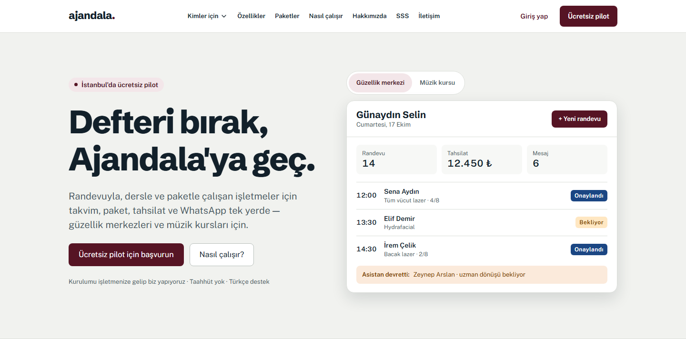

# Ajandala

[Türkçe](README.md) · **English**

Appointment, package, payment and WhatsApp management for beauty centers that sell multi-session packages, and for music schools. One flow from a WhatsApp inquiry to a documented package sale, payment collection, capacity-aware session planning and renewal.

**Live:** [ajandala.com](https://ajandala.com) (Turkish market only)

> **Status:** Free pilot in Istanbul. The application source is private; this repository only presents the product and its architecture.

## What it does

| Area | Capability |
|---|---|
| Calendar | Day/week views per staff and device, double booking blocked in the database, online booking with salon approval |
| Packages | Session tracking, freezing, expiry, suggested next session, 8-week capacity view |
| Sales & payments | Documented package offers (distance-sales consent), instalments, deposits and payment links, cash register |
| WhatsApp | Reminders from the salon's own number, confirm/cancel links, shared inbox, opt-in-aware campaigns |
| AI assistant | WhatsApp assistant that reads prices and free slots only through tools and hands off medical questions, complaints and discounts to a human |
| Customer side | No app, no account: tokenized links for remaining sessions, offers, consent forms and bookings |
| Admin panel | All tenants, time-boxed support mode with owner notification, audit log, mandatory MFA |

The same codebase serves **music schools** (1:1 and group lessons, attendance, make-ups, monthly tuition, guardians, trial lessons). Sector-specific features are gated by plan features **in the database as well**, not just hidden in the UI.

## Stack

| Layer | Components |
|---|---|
| App | Next.js 16 · React 19 · TypeScript strict · Tailwind 4 · shadcn/ui |
| Data | Supabase — PostgreSQL, Auth, Row Level Security, Storage, Vault, pg_cron · Frankfurt |
| AI | Anthropic Claude with tool use (behind an `LLMProvider` interface) |
| Messaging | WhatsApp Cloud API · Resend |
| Payments | iyzico / PayTR (TRY, instalments) |
| Testing | Vitest · Playwright · pgTAP · AI scenario evals |

## Architecture notes

- Multi-tenancy enforced by RLS on every table; no table ships without a policy and a test. The service key lives only in `server-only` modules, and the build fails if it leaks to the client.
- Double booking is impossible: `EXCLUDE USING gist` constraints per staff member and device; group-lesson capacity via a locking trigger.
- Money as `bigint` minor units, time as `timestamptz` with Europe/Istanbul business logic.
- Outbound messages go through a Postgres outbox drained by pg_cron, with no separate queue service.
- Health data is kept in separate tables and never reaches the LLM, logs or analytics.
- Webhooks are signature-verified and idempotent; customer links use ≥128-bit hashed, expiring, rate-limited tokens.

| Metric | Value |
|---|---|
| Database migrations | 55 |
| pgTAP SQL test files | 45 |
| Unit test files | 106 |
| Playwright e2e specs | 43 |
| Pages & routes | 145 |
