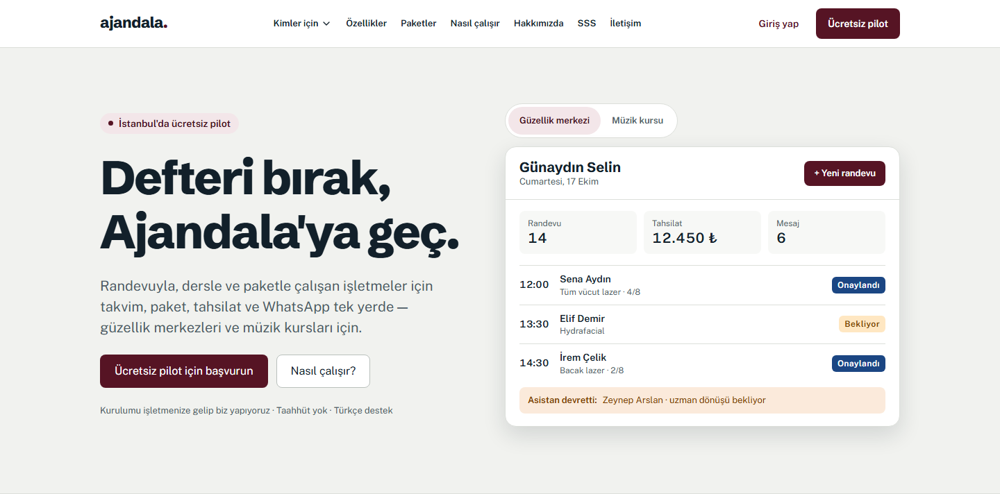
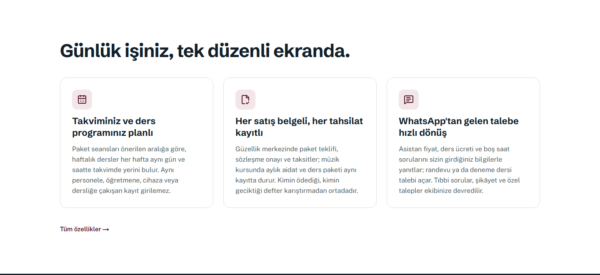
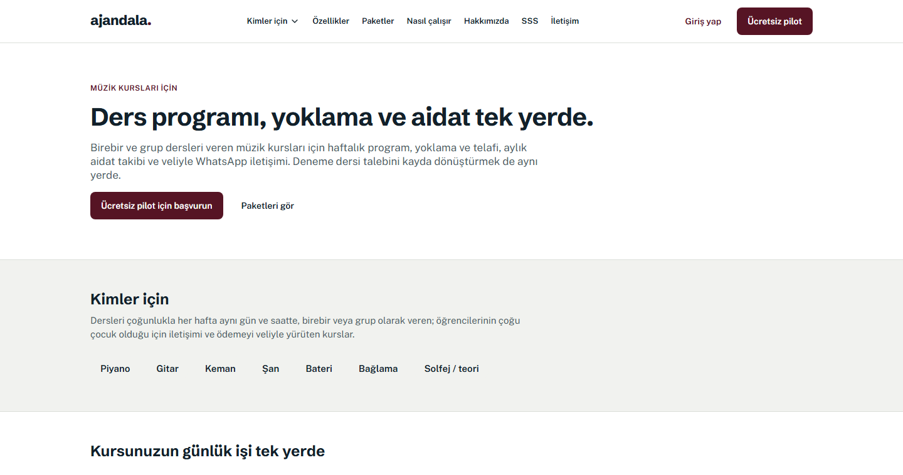
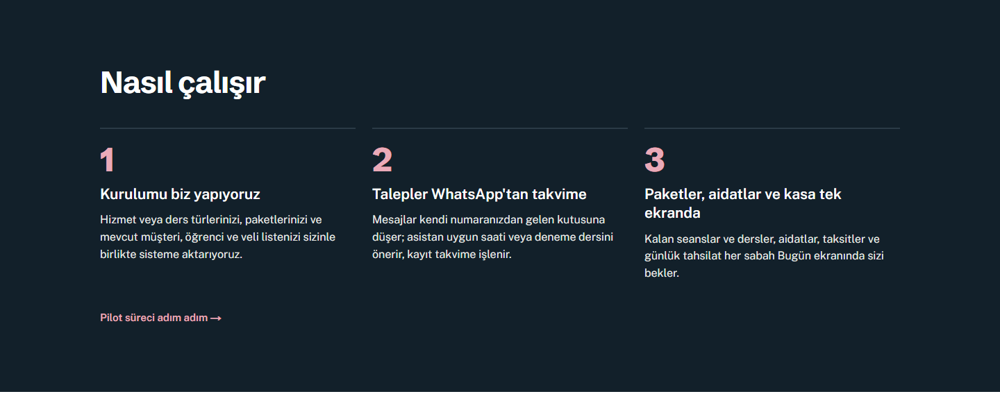
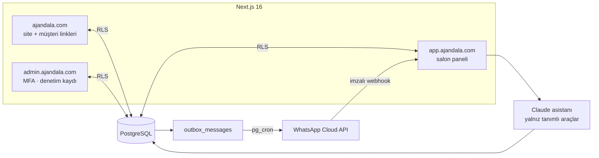

# Ajandala

**Türkçe** · [English](README.en.md)

Randevuyla, dersle ve paketle çalışan işletmeler için randevu, paket, tahsilat ve WhatsApp yönetimi: güzellik merkezleri, müzik kursları, spor ve pilates stüdyoları, diyetisyenler, danışmanlık merkezleri, çocuk spor ve sanat kursları, dil ve etüt merkezleri. WhatsApp'tan gelen talebi belgeli paket satışına, tahsilata, kapasiteye göre seans planına ve paket bitiminde yenilemeye kadar tek akışta yönetir.

**Canlı:** [ajandala.com](https://ajandala.com)

> **Durum:** İstanbul'da ücretsiz pilot aşamasında. Uygulama kaynak kodu özel depodadır; bu depo yalnızca ürünü ve mimarisini tanıtır.

## Ne yapar

| Alan | İşlev |
|---|---|
| Takvim | Personel ve cihaz bazında gün/hafta görünümü, çakışmanın veritabanında engellenmesi, online randevu ve salon onayı |
| Paket ve seans | Seans düşümü, dondurma, süre takibi, önerilen sonraki seans, 8 haftalık kapasite görünümü |
| Satış ve tahsilat | Belgeli paket teklifi (mesafeli satış onayı), taksit, kapora ve ödeme linki, kasa |
| WhatsApp | Salonun kendi numarasından hatırlatma, onay/iptal linki, ortak gelen kutusu, toplu kampanya (İYS onayına göre) |
| AI asistan | Fiyat ve uygun saatleri yalnız araçlardan okuyup randevu öneren, tıbbi soru/şikâyet/indirimde insana devreden WhatsApp asistanı |
| Müşteri tarafı | Uygulama ya da hesap yok: "kalan seanslarım", teklif, onam formu ve randevu sayfaları token'lı linklerle |
| Yönetim paneli | Tüm salonlar, destek modu (süreli, gerekçeli, salon sahibine bildirimli), denetim kaydı, zorunlu MFA |

### Farklı sektörler, tek kod

Her işletme türü kendi terimleri ve bölümleriyle açılır. Örneğin müzik kursunda: birebir ve grup dersleri, yoklama, telafi, aylık aidat, veli iletişimi ve deneme dersi sayfası. Sektöre özgü bölümler plan özellikleriyle açılır ve **veritabanında da kapılıdır**; yalnız ekranı gizlemekle yetinilmez. Sektöre göre değişen terimler (müşteri → öğrenci, seans → ders …) tek bir sözlükten gelir.

### Nasıl çalışır

## Paketler

| | Başlangıç | Büyüme | Pro |
|---|---|---|---|
| Aylık (KDV hariç) | 990 ₺ | 1.500 ₺ | 2.500 ₺ |
| Personel / şube | 3 / 1 | 8 / 1 | 20 / 3 |
| AI asistan | — | 300 konuşma / ay | 800 konuşma / ay |

Limitler koda gömülü değildir; `(sektör, plan)` anahtarlı bir tablodan okunur.

## Teknoloji

| Katman | Bileşen |
|---|---|
| Uygulama | Next.js 16 (App Router, `proxy.ts`, cache components) · React 19 · TypeScript strict · Tailwind 4 · shadcn/ui |
| Veri | Supabase — PostgreSQL, Auth, Row Level Security, Storage, Vault, pg_cron · Frankfurt |
| AI | Anthropic Claude, araç kullanımı ile (`LLMProvider` arayüzü arkasında) |
| Mesaj | WhatsApp Cloud API (`MessagingProvider`) · Resend (`EmailProvider`) |
| Ödeme | iyzico / PayTR, TL ve taksit (`PaymentProvider`) |
| Test | Vitest · Playwright · pgTAP · AI senaryo testleri |

## Mimari

Tek bir Next.js uygulaması alan adına göre üç yüze ayrılır; ayrı mikroservis ya da kuyruk sistemi yoktur. Kuyruk Postgres'teki bir outbox tablosu ve pg_cron'dur.

### Tasarım kararları

- **Çok kiracılık veritabanında:** her iş tablosunda `tenant_id`, her tabloda RLS. Yeni tablo ancak RLS politikası ve testiyle eklenir. Servis anahtarı yalnız `server-only` modüllerde; istemci paketine sızarsa derleme kırılır ve CI ayrıca tarar.
- **Çifte randevu imkânsız:** personel ve cihaz için `EXCLUDE USING gist` kısıtı; grup derslerinde kontenjan kilitli tetikleyiciyle.
- **Para kuruş cinsinden `bigint`**, saatler `timestamptz` ve iş mantığı Europe/Istanbul.
- **Mesajlar doğrudan gönderilmez:** önce outbox'a yazılır, zamanlayıcı gönderir. 24 saat penceresi kapalıysa yalnız onaylı şablon, pazarlama mesajı yalnız İYS onayı olana.
- **Sağlık verisi ayrı tablolarda**, yalnız yetkili rollere açık; LLM'e, loglara ve analitiğe asla gitmez. Yönetim panelinde ve destek modunda da görünmez.
- **Webhook'lar** imza doğrulamalı ve idempotent: önce kaydedilir, sonra işlenir.
- **Müşteri linkleri** en az 128 bit token, veritabanında hash'li, süreli ve rate limit'li.
- **Yasal kabuller** belge versiyonu, içerik hash'i, zaman, IP ve user-agent ile saklanır (KVKK, mesafeli satış).

## Mühendislik

| Metrik | Değer |
|---|---|
| Veritabanı migration'ı | 55 |
| pgTAP SQL test dosyası | 45 |
| Birim test dosyası | 106 |
| Playwright uçtan uca test | 43 |
| AI senaryo seti | güzellik + müzik |
| Sayfa ve route | 145 |

---

Emin Özbayraktar · [github.com/LightWonkas](https://github.com/LightWonkas)
